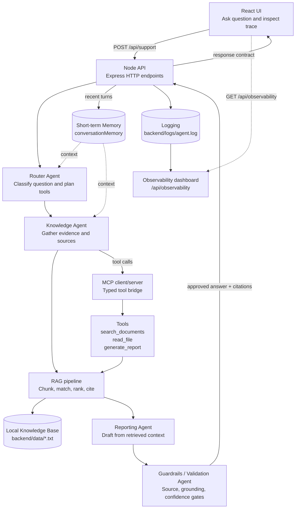
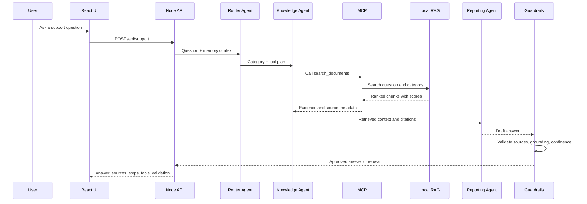

# Agentic Support Architecture

This project is a local, grounded support agent. The React UI sends a question to the Node API, which routes the request, retrieves evidence from the local knowledge base, drafts a response, validates it, and returns citations and observability data.

## System Architecture

## Request Flow

## Component Guide

### React UI

The frontend in `frontend/src` provides the question form, example prompts, agent trace, confidence indicator, citations, validation results, and observability dashboard. It calls `POST /api/support` and renders the stable `SupportResponse` contract returned by the backend.

### Node API

The Express application in `backend/src/index.js` is the orchestration boundary. It accepts requests, manages conversation memory, invokes the agent pipeline, records request telemetry, and exposes the support, tool, agent, and observability endpoints.

### Router Agent

The Router Agent classifies the question as React, Node.js, or general support. It creates a tool plan, choosing document search, a named file read, or document search followed by report generation.

### Knowledge Agent

The Knowledge Agent executes the Router Agent's plan through the MCP client. It returns retrieved chunks, file reads, tool-call results, and source metadata to the Reporting Agent. It is the evidence-gathering stage of the pipeline.

### RAG

RAG, or retrieval-augmented generation, keeps the answer grounded in project documents. Here it consists of loading files, splitting them into paragraph chunks, matching meaningful question words against chunk words, ranking the matches, and passing the selected text to the Reporting Agent. The project uses local keyword retrieval rather than a hosted model or vector database.

### Local Knowledge Base

The source documents live under `backend/data` as `.txt` files. Each paragraph becomes a stable chunk with an ID such as `react-basics.txt#2`, its source filename, title, chunk number, text, and match score. Keeping the files local makes the example deterministic and easy to inspect.

### Memory

Short-term conversation memory is held in the backend's `conversationMemory` map. The last ten turns for a conversation can be included as context for routing and retrieval, and the response returns the recent history used by the UI.

### MCP

The Model Context Protocol client in `backend/src/mcp-client.mjs` starts the local MCP server and discovers its tools. MCP gives the Knowledge Agent a structured boundary for requesting retrieval, reading a file, and generating a report without coupling the agent orchestration to tool implementation details.

### Tools

The MCP server registers three tools:

- `search_documents` searches ranked chunks in the local knowledge base.
- `read_file` returns one named `.txt` document for explicit file requests.
- `generate_report` combines retrieved chunks into a report for the Reporting Agent.

### Reporting Agent

The Reporting Agent formats the retrieved evidence into a response draft. It receives context and source names from the Knowledge Agent and does not independently search the filesystem.

### Guardrails

The Validation Agent is the final safety and quality gate. It checks that returned chunks and files still match the local knowledge base, measures draft grounding against the retrieved evidence, applies the confidence threshold, and returns a refusal when evidence is missing or insufficient.

### Logging

Each request is appended as JSON to `backend/logs/agent.log`. Logs include request IDs, selected tools, MCP durations and statuses, retrieved sources, confidence, validation, the final response, and errors.

### Observability Dashboard

The `/observability` React view reads `/api/observability` and summarizes request volume, refusal rate, confidence, MCP usage, errors, source coverage, tool usage, source usage, and recent requests. It makes the agent's decisions and operational behavior inspectable.

## Source and Response Contract

The pipeline preserves source identity from retrieval through the final response. Each citation contains the source filename, title, chunk number, and score. The frontend receives the same `SupportResponse` shape for answers, sources, confidence, validation, reasoning, tools, steps, memory, and refusal state.
